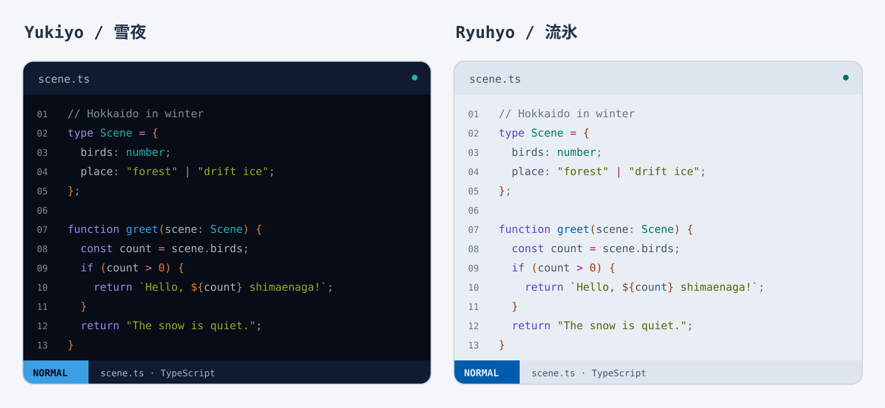

# shimaenaga.nvim

**English** | [日本語](README.ja.md)


**Shimaenaga** (Long-tailed tit. Scientific name: *Aegithalos caudatus caudatus*) is
a Neovim colorscheme inspired by the colors of Hokkaido, Japan.
Available in **Yukiyo 雪夜** (dark) and **Ryuhyo 流氷** (light).
Includes highlights for standard syntax, Treesitter, LSP, and Neovim plugins, plus the palette for Neovim’s built-in terminal.

This repository focuses on the Neovim colorscheme and its plugin integrations.
The banner artwork was generated with Gemini and its colors were adjusted using OpenAI image generation.

## Installation

Example configuration for lazy.nvim. Tested with Neovim 0.12.6.

```lua
{
  "tackaaaada/shimaenaga.nvim",
  lazy = false,
  priority = 1000,
  opts = { transparent = false },
  config = function(_, opts)
    require("shimaenaga").setup(opts)
    vim.cmd.colorscheme("shimaenaga-yukiyo")
  end,
}
```

For a local checkout, replace the repository specification with
`dir = vim.fn.expand("/path/to/shimaenaga.nvim")` and `name = "shimaenaga.nvim"`.
For LazyVim, also configure the following and remove conflicting settings that load another colorscheme directly:

```lua
{ "LazyVim/LazyVim", opts = { colorscheme = "shimaenaga-yukiyo" } }
```

Use `shimaenaga-ryuhyo` for the light variant. The `shimaenaga` alias follows `background=dark/light`.

## Transparency and customization

```lua
require("shimaenaga").setup({
  transparent = true,
  styles = {
    sidebars = "transparent",
    floats = "transparent",
  },
  on_colors = function(colors)
    -- colors.blue = "#3c9ee3"
  end,
  on_highlights = function(highlights, colors)
    -- highlights.Comment = { fg = colors.comment, italic = true }
  end,
})
```

Transparency clears background colors for the editor, floating windows, and related surfaces.
Configure actual opacity and blur in your terminal and compositor.
The statusline keeps its colored bands even when transparency is enabled.

For Lualine, set the theme and separators while keeping your existing components:

```lua
{
  "nvim-lualine/lualine.nvim",
  opts = { options = {
    theme = "shimaenaga",
    section_separators = { left = "", right = "" },
    component_separators = { left = "", right = "" },
  } },
}
```

## Palette

| Role | Color |
| --- | --- |
| Keywords | Purple |
| Functions | Blue |
| Types and built-in types | Cyan |
| Strings | Green |
| Numbers and constants | Orange |
| Operators | Cooler cherry blossom pink in Yukiyo |
| Special characters | Cherry blossom pink |
| Variables, parameters, and properties | Main text color |
| Brackets | A blend of orange and the main text color |
| Warnings | Yellow |
| Errors and deleted diff lines | Red |

Yukiyo uses `#070c17` for the editor background, `#0b1221` for menus, and `#111b2f` for the statusline.
Ryuhyo uses a soft blue-white background, `#e3eaf2`.
See the [palette specification](docs/color-spec.md) and [highlight coverage](docs/highlight-scope.md) for details (Japanese).

## Preview



This illustration uses the default opaque palettes. Actual rendering also depends on your syntax parser and transparency settings.

Run from the checkout root. The preview does not change your regular Neovim configuration.

```sh
nvim --clean -c 'luafile scripts/color-preview.lua'
```

Press Tab to switch between Yukiyo and Ryuhyo, t to toggle transparency, and [ / ] to navigate 11 pages.
In Yukiyo, b cycles through three background candidates; in Ryuhyo, it compares white backgrounds. Exit with `:q!`.
To preview the loaded colorscheme itself, use `scripts/preview.lua`.

## Development and validation

The source palette is `lua/shimaenaga/palette.lua`.
After changing it, regenerate the code illustration with `python scripts/render-code-preview.py`.
Use Neovim and Python 3.11 or later to run the standalone checks:

```sh
python scripts/check.py
```

This runs the existing checks for palettes, highlights, transparency, previews, and statusline colors.
No export generation step or separately installed plugin is needed.
To also check real Lualine rendering, point the check at an installed Lualine checkout:

```sh
SHIMAENAGA_LUALINE_PATH=/path/to/lualine.nvim python scripts/check.py
```

See [verification.md](docs/verification.md) for validation coverage and optional LazyVim checks,
and [architecture.md](docs/architecture.md) for the design (both in Japanese).
`build/` contains validation logs, local configuration copies, and recovery data, and is excluded from Git.

## License and attribution

Apache-2.0. See [LICENSE](LICENSE) and [UPSTREAM.md](UPSTREAM.md).
Highlight integrations are derived from [Solarized Osaka](https://github.com/craftzdog/solarized-osaka.nvim).
